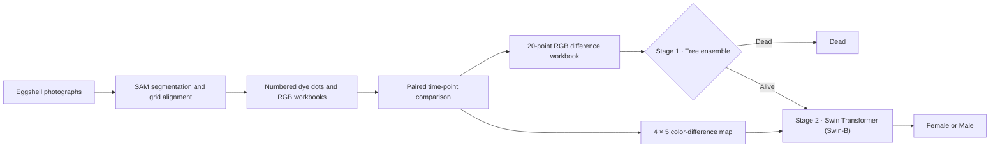
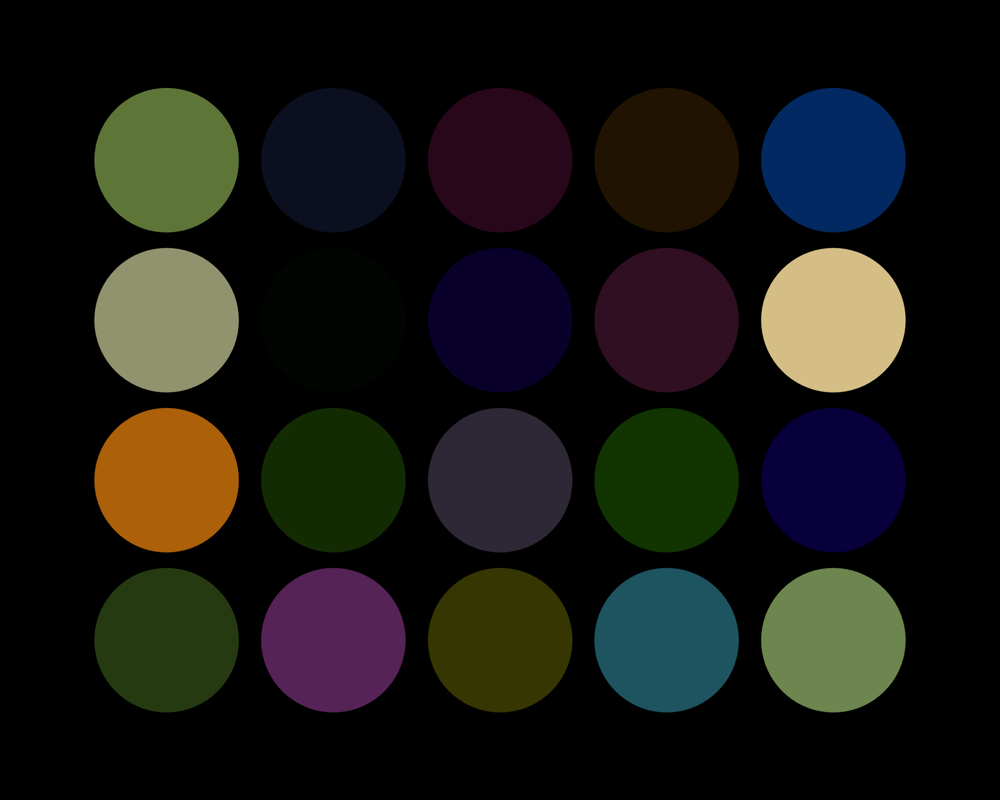
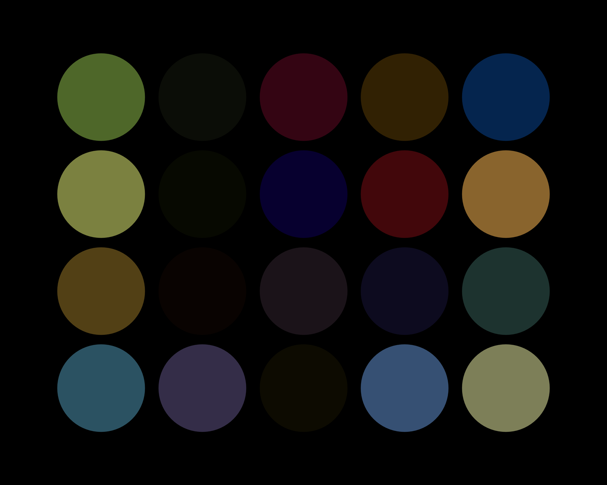
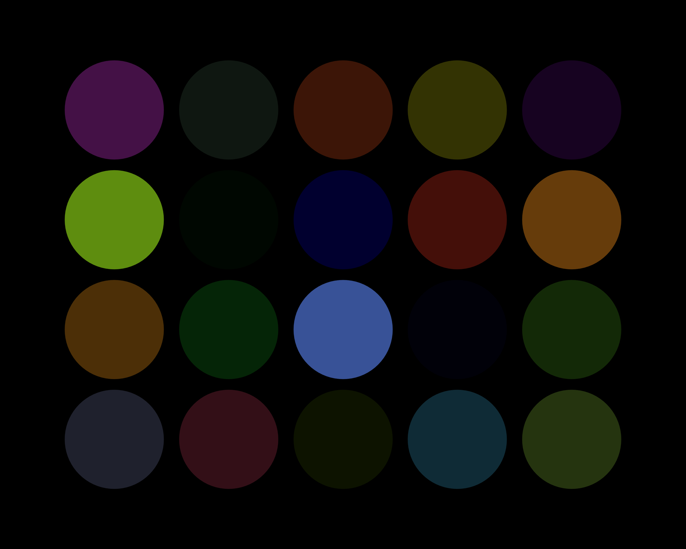

# Tatoo

**Eggshell dye-dot detection, RGB difference mapping, and two-stage egg classification**

Tatoo turns photographs of a 20-dot eggshell tattoo into ordered color measurements. It uses the orientation of the egg to number the dots consistently, compares measurements from two time points, and renders the changes as a 4 × 5 color-difference map. The classification workflow uses the resulting spreadsheets and images to predict `Dead`, `Female`, or `Male`.

## Workflow



### Example outputs

These three Batch-3 examples pair an enhanced PNG with the corresponding absolute RGB differences in Excel.

| Female · Egg 3 | Male · Egg 9 | Dead · Egg 7 |
| :---: | :---: | :---: |
|  |  |  |
| [RGB workbook](classification/input_data/excel/Batch-3/Female/egg_3.xlsx) | [RGB workbook](classification/input_data/excel/Batch-3/Male/egg_9.xlsx) | [RGB workbook](classification/input_data/excel/Batch-3/Dead/egg_7.xlsx) |

## Installation

Create a Python virtual environment. Install compatible builds of `torch` and `torchvision` for your CPU or CUDA environment before installing Segment Anything. [PyTorch installation guide](https://pytorch.org/get-started/locally/)

For detection, RGB extraction, and color mapping, install the following packages. Git must be available for the SAM installation. [Segment Anything installation guide](https://github.com/facebookresearch/segment-anything#installation)

```bash
python -m pip install numpy pandas openpyxl opencv-python
python -m pip install "git+https://github.com/facebookresearch/segment-anything.git"
```

For Excel-to-PNG conversion alone, install the packages on the first line of the preceding block. For classifier training and prediction, install the additional packages below. Install `shap` separately to generate SHAP diagnostics.

```bash
python -m pip install numpy pandas openpyxl pillow scipy matplotlib scikit-image scikit-learn
python -m pip install xgboost lightgbm optuna tqdm tensorboard timm
```

## Generate color-difference maps

### 1. Detect and review the dye dots

Run the preprocessing commands from `preprocessing/`. The batch script reads `*.jpg` from `src/good/` and `src/bad/`. Keep the filename stems unique within a run, since the two input directories share the same output directory.

```bash
cd preprocessing
python run_all.py
```

The detector locates the egg, uses SAM ViT-B to segment candidate dots, and fits a grid oriented by the egg tip. The first run downloads `sam_vit_b.pth` if it is absent from the working directory. For offline use, place the official ViT-B checkpoint in that directory under the same filename. [SAM checkpoints](https://github.com/facebookresearch/segment-anything#model-checkpoints)

Manual review opens by default. Drag to move a dot, use `Tab` or `n` to select the next dot, and use the arrow keys for fine adjustments. Press `Enter` to accept the image or `Esc` to skip it. Use `--no-manual-adjust` for unattended runs or `--from-cache` to reuse earlier detections for review and color sampling.

To process one image directly, pass its path to the detector.

```bash
python detect_dots_sam_v4_lxy.py path/to/egg_3.jpg --no-manual-adjust
```

The `results/` directory holds the detection cache (`*_cache.json`), sampling results (`*_result.json`), and an annotated preview (`*_result.jpg`).

### 2. Export ordered RGB measurements

```bash
python extract_colors.py
```

The script samples the recorded contours on the source photographs, filters unusually dark pore pixels, and computes median RGB values. It writes one workbook per image plus `color_excel/all_eggs_summary.xlsx`.

Process the two time points in separate runs and save each summary before starting the other run. Keep the source images and `results/` for each run separate. The exporter assigns egg IDs by the order of successfully read images, so reconcile the IDs against the original image records before comparing dates.

### 3. Compare the two time points

Run the example with the bundled `0.xlsx` and `3.xlsx`. For a new experiment, place your own baseline and follow-up workbooks beside `diff_eggs.py` under those names.

Use `Egg ID`, `Point Number`, `Red`, `Green`, and `Blue` for new workbooks. The script also recognizes the original Chinese headers used in older exports. Use a stable numeric ID for each egg and arrange the 20 points in the same order in both files. The script matches egg IDs and compares rows within each egg by position.

```bash
python diff_eggs.py
```

For each matching egg, the script writes a 2500 × 2000 PNG and a companion workbook. Each output directory also contains `summary.xlsx`.

| Output | Per-channel value |
| --- | --- |
| `abs/` | Absolute difference `d = abs(follow_up - baseline)` |
| `enhanced/` | Scaled and clipped difference `min(255, (d * 255) // 130)` |

## Two-stage classification architecture

### Stage 1 · Tree ensemble for viability

Stage 1 estimates the probability that an egg belongs to the `Dead` class. During training, `Female` and `Male` are grouped as `Alive` (`0`), and `Dead` is the positive class (`1`). Each workbook supplies 20 ordered RGB triplets. Feature version `v1` flattens them into 60 values. The default `v2` uses 423 features from per-point RGB, HSV, and Lab values, channel statistics, and adjacent-point differences. [Workbook loader](classification/xgb_data.py) · [Feature construction](classification/features.py)

| Base model | Training configuration | Ensemble weight |
| --- | --- | ---: |
| XGBoost | Histogram-based boosting with class weighting, early stopping, and Optuna hyperparameter search | 40% |
| LightGBM | Binary gradient boosting with imbalance handling and early stopping | 20% |
| Random Forest | 800 trees with balanced class weights | 20% |
| Extra Trees | 800 randomized trees with balanced class weights | 20% |

Each model family's predictions are averaged across its training seeds. The weighted ensemble combines those family averages using the weights above. When stacking is enabled and the training split is large enough, the script also fits a logistic regression model on five-fold out-of-fold probabilities. It selects the final combination by validation accuracy at the respective tuned thresholds. Use `--no_stack` to export the weighted ensemble directly. [Stage 1 trainer](classification/train_stage1_v2.py)

The trainer searches thresholds from 0.05 to 0.95 using accuracy by default or dead-class F1 with `--prefer_metric f1_dead`. It saves the threshold, feature version, and fitted models in `stage1_bundle.pkl`. It supports stratified random validation and leave-one-batch-out evaluation, with ROC and precision–recall curves, confusion matrices, calibration plots, and optional SHAP reports. [Bundle loading and routing](classification/predict.py)

### Stage 2 · Swin Transformer for sex classification

Stage 2 processes the spatial color-difference map for each egg that passes the viability gate with `p_dead < threshold`. The model uses **Swin-B**, a hierarchical vision transformer with shifted-window attention and patch merging. Its two-class head uses the fixed order `Female` (`0`) and `Male` (`1`). [Swin-B model definition](classification/stage2_train/model.py) · [Inference class mapping](classification/stage2_io.py)

| Component | Configuration |
| --- | --- |
| Training input | RGB color-difference map, resized proportionally and centered on a black 224 × 224 canvas, then normalized with ImageNet statistics |
| Patch and window sizes | 4 × 4 pixel patches and 7 × 7 token attention windows |
| Swin stages | Block depths of `[2, 2, 18, 2]` and attention head counts of `[4, 8, 16, 32]` |
| Base embedding width | 128 channels |
| Optimization | AdamW with linear warmup and cosine learning-rate decay. Mixed precision is configurable. |
| Validation | Stratified holdout or stratified K-fold. The best checkpoint is selected by validation accuracy. |

The trainer can initialize the backbone with ImageNet-22K Swin-B weights, then fine-tune the network and its new two-class head on labeled color-difference maps. Use `--freeze-layers` to train only the head. The trainer exports per-egg predictions, confusion matrices, and ROC and precision–recall data. **The trained Stage 2 checkpoint is intentionally omitted.** The Stage 1 bundle and the color-difference workflow are available independently. [Stage 2 trainer](classification/stage2_train/train_v2.py)

## Train the classifiers

### Dataset layout

Provide a labeled training dataset organized by batch. The three included pairs demonstrate the file format and directory structure. Training requires additional labeled examples.

```text
classification/input_data/
├── excel/Batch-3/
│   ├── Dead/egg_7.xlsx
│   ├── Female/egg_3.xlsx
│   └── Male/egg_9.xlsx
└── image/Batch-3/
    ├── Dead/egg_7.png
    ├── Female/egg_3.png
    └── Male/egg_9.png
```

Each Excel file must have 20 rows of measurements with numeric `Red`, `Green`, and `Blue` as the final three columns. Use identical stems for the paired workbooks and images. Stage 1 reads Batch-3, Batch-4, and Batch-5 when those folders are present. Stage 2 training uses images from the `Female` and `Male` folders.

### Training commands

With the full dataset and the pretrained Swin-B checkpoint in place, run the Bash wrapper from the repository root. Use Bash on Linux or in WSL. Set `EXCEL_ROOT`, `IMAGE_ROOT`, and `PRETRAINED_SWIN` to absolute paths to use inputs outside the default locations.

```bash
FIXED_SEED=1001 bash classification/run_all.sh
```

The wrapper trains Stage 1, rebuilds the generated `classification/runs/fm_flat/` directory, and launches `classification/stage2_train/train_v2.py`. With the default output root, it writes `classification/runs/stage1/stage1_bundle.pkl` and `classification/runs/stage2_seed_1001/weights/best.pth`. The wrapper also attempts a prediction smoke test on the first batch's `Male` directory.

To train each stage separately, run the following commands from `classification/` using the full dataset.

```bash
python train_stage1_v2.py --data_root input_data/excel --out_dir runs/stage1 --mode random --final_split random
python stage2_train/train_v2.py --data-path input_data/image --weights pretrained/swin_base_patch4_window7_224_22k.pth --out_dir runs/stage2 --seed 1001
```

Place the ImageNet-22K Swin-B 224 × 224 checkpoint at `classification/pretrained/swin_base_patch4_window7_224_22k.pth`. This checkpoint initializes training. Prediction requires a checkpoint fine-tuned for the two egg classes. [Microsoft Swin Transformer model hub](https://github.com/microsoft/Swin-Transformer/blob/main/MODELHUB.md)

## Run prediction

### Full cascade

The `predict.py` command requires a Stage 1 bundle and a trained Stage 2 checkpoint. Use this command once your own two-class checkpoint is available. Use model files from trusted sources.

> **Checkpoint compatibility.** The current predictor uses resize and center crop. The bundled Stage 2 trainer uses aspect-ratio-preserving resize with black padding. Match the inference transform to the training transform for the checkpoint before evaluating its predictions.

From `classification/`, the following Bash example uses that Stage 1 bundle and a Stage 2 checkpoint produced by the standalone training command.

```bash
python predict.py \
  --stage1_model runs/stage1_weighted/stage1_bundle.pkl \
  --stage2_ckpt runs/stage2/weights/best.pth \
  --excel input_data/excel/Batch-3/Female/egg_3.xlsx \
  --image input_data/image/Batch-3/Female/egg_3.png \
  --output_csv runs/predictions.csv
```

For batch inference, use `--excel_dir` and `--image_dir` in place of the single-file arguments. The script pairs XLSX and PNG files by stem. The CSV includes the predicted label, confidence, and class probabilities. Female and male probabilities are populated for samples routed to Stage 2.

## Source guide

| Entry point | Purpose |
| --- | --- |
| [`preprocessing/run_all.py`](preprocessing/run_all.py) | Batch detection, manual review, and cached reprocessing |
| [`detect_dots_sam_v4_lxy.py`](preprocessing/detect_dots_sam_v4_lxy.py) | Egg localization, SAM segmentation, grid fitting, dot numbering, and color sampling |
| [`extract_colors.py`](preprocessing/extract_colors.py) and [`diff_eggs.py`](preprocessing/diff_eggs.py) | Workbook export, paired RGB comparison, and map rendering |
| [`sort_eggs_by_label.py`](preprocessing/sort_eggs_by_label.py) | Utility for copying images into known label folders using a configured image directory and batch-specific egg IDs |
| [`train_stage1_v2.py`](classification/train_stage1_v2.py), [`xgb_data.py`](classification/xgb_data.py), and [`features.py`](classification/features.py) | Spreadsheet loading, feature extraction, ensemble training, and evaluation |
| [`stage2_train/`](classification/stage2_train) | Swin architecture, dataset, training and evaluation utilities, and the Stage 2 entry point |
| [`predict.py`](classification/predict.py) and [`stage2_io.py`](classification/stage2_io.py) | Checkpoint loading, image transforms, input pairing, and cascade inference |

For a source release, keep pretrained binaries, full datasets, and generated run outputs outside ordinary Git history. Publish the small example pairs with the code, and document where to obtain any model files required for inference. [GitHub guidance on large files](https://docs.github.com/en/repositories/working-with-files/managing-large-files/about-large-files-on-github)
